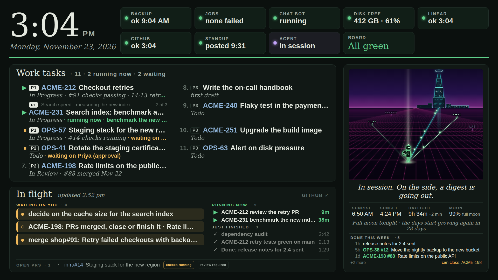

# easel

A wall-screen work board for you and your AI agent. Easel is a board for a developer who works with an AI coding assistant. During work hours it answers three questions at a glance, from across the room: **what is on my plate, what is waiting on me, and what is running right now.**

It reads Linear and GitHub (read-only), a plain notes file the assistant keeps, and a record of the assistant's background agents, and shows them on a 1920x1080 page that a kiosk browser (full screen, no controls) keeps on a monitor all day. It never writes to Linear or GitHub.



_The screenshot is made from invented data with `scripts/demo.py` and `scripts/screenshot.py` (headless Chromium)._

- Author: Dan Pittman (https://github.com/dpdanpittman)
- License: AGPL-3.0 (see [LICENSE](LICENSE))
- Pairs with [Essence](https://github.com/dpdanpittman/essence): easel reads a sketchbook's `current.md` ([Essence's sketchbook](https://github.com/dpdanpittman/essence/blob/main/docs/sketchbook.md)), namely its In flight block and its work list block. Any append-only notes file written in that grammar works. See [The notes file](#the-notes-file).
- The name: Essence speaks in painting terms (portrait, landscapes, strokes, brushes, sketchbook). The easel is where the work stands, in view, while it is being made.

## What it shows

```
+--------------------------------------------------------------------------------------+
| 3:04 PM          [Backup] [Jobs] [Chat bot] [Disk] [Linear]                           |
| Monday, ...      [GitHub] [Standup] [Agent: in session] [Board: All green]            |  status strip
+------------------------------------------------------------+-------------------------+
| WORK TASKS  11 · 2 running now · 2 waiting                  |                         |
|  1 P1 ACME-212 ...  In Progress · #91 ...|  8 P3 Write ...   |    the grid (scene)     |
|    P1 Search speed · measuring   2 of 3 |  9 P3 ACME-240 ... |                         |
|  2 ACME-231 ...     running now · ...   | 10 ...             |                         |
+------------------------------------------------------------+-------------------------+
| IN FLIGHT                    updated 2:52 pm    GitHub ✓    | caption                 |
| Waiting on you · 4           | Running now · 2              | sunrise, sunset, moon   |
|   decide on the cache size   |   ACME-212 review the PR  9m |-------------------------|
|   ACME-198: PRs merged, ...  | Just finished · 3            | Done this week · 5      |
|   merge shop#91: ...         |   2:42 dependency audit      |   1h release notes ...  |
| Open PRs: infra#14 checks running                           |   can close: ACME-198   |
+------------------------------------------------------------+-------------------------+
```

Outside work hours the work panels leave the screen and the left column says "Off the clock." The server's clock decides, not the browser's, and the switch happens on the running page without a reload.

### Status strip (top)

The clock and date in the configured timezone, then one tile per configured check (`[status] tiles`, in order): failed systemd user units, disk free, uptime, a long-running service, a timer-driven job (last run ok and when), and in work hours the age of the last good Linear fetch, the last good GitHub fetch, and a standup job's record. Then the assistant's tile ("in session" while a Claude Code transcript was written in the last two minutes; file times only, never content) and a verdict tile: "All green", "Have a look" or "Needs you". Tiles are green when fine, amber when unsure, red when wrong. The page polls every 15 s; the server caches for 10 s.

### Work tasks (left, top)

One row per open ticket: number, priority (P1 to P3), ticket id, title and a state line. The heading always shows the real count.

- **Linear is the source of truth.** The list starts from the open issues assigned to the key's user in every configured workspace ("open" = not completed, canceled or duplicate). A Linear issue in Backlog shows only when the notes file names it.
- **The notes file adds overrides.** The newest WORK TASKS block wins. A line that starts with a ticket id keeps its priority, title and order. A ticket the notes name but Linear no longer has open drops off, but only when that ticket's workspace answered. A line that starts with words stays exactly as written.
- **Order:** priority, then the notes order, then the Linear id. Linear priority maps Urgent = P1, High = P2, anything else P3, unless the notes set it.
- **State lines come from facts, in this order of trust:** the live Linear state ("In Review"); the PRs that name the ticket ("Refs ACME-212" in the body, also Closes, Fixes, Resolves, Part of, or the id in the branch name): open first ("#91 checks passing"), then a draft, then a PR merged in the last 48 hours; the newest finished line that names it; and the hand note from the notes file, only within 4 hours of its block and always after the facts. Nothing is guessed. With nothing known, the old note shows with its age ("as of Nov 19 11:54: ...").
- **Waiting and running flags** come from the current IN FLIGHT block: a W line naming the ticket marks it "waiting on you · <the line>", an R line or a running background agent "running now · <text>". Ids match as whole tokens (OPS-57 never matches OPS-577). A hand "WAITING ON: Priya" still shows because it names someone else.
- **Grouped rows.** A notes line whose title names several tickets ("Search speed ACME-230/231/232", "ACME-1, ACME-2", "ACME-1 & 2") becomes one row that shows one ticket at a time every 5 seconds, each with its own live title and state, under the line's own label with "2 of 3". The row never changes height while it cycles. Closed tickets drop out; one left is a normal row.
- **No short list.** If a Linear workspace has nothing usable (first start, or failing longer than the saved answer lasts), the list is held back with a plain message ("Loading the list from Linear…") rather than shown without that workspace's tickets.

### In flight (left, bottom)

The live answer to "what's waiting on me?". Four groups:

1. **Waiting on you** (amber): W lines from the notes file; your open, non-draft PRs whose checks all pass ("merge shop#91: ...", with the review state); and an automatic line, "ACME-198: PRs merged, close or finish it", for any ticket that is In Review in Linear with at least one linked PR merged and none open; and "#88 api: approved 3d ago, not merged · behind" for an open PR anyone else wrote whose newest review by you (approve, request changes or dismiss; comments do not count) is an approval older than `github.approved_after_h` hours (48 by default, 0 turns it off), with its merge state (behind, conflicting, blocked or clean) and its CI pill. A ticket id from the PR's title, body or branch leads that line, so the task row picks it up. A hand W line for the same ticket or PR wins. A PR you approved that someone else drives can be muted: put `repo#n` on a line of `github.approved_mute_file` (`~/.config/easel/approved-mute.txt` by default; `#` comments allowed) and it moves to Open PRs as "watching".
2. **Running now** (green): background agents from the hook record, plus R lines. Each shows how long it has run; an agent silent for 45 minutes shows "no word since HH:MM" instead; after 12 hours of silence it is dropped as a crashed session.
3. **Just finished** (dimmed): agents finished in the last 18 hours plus F lines, newest first.
4. **Open PRs** (a quiet line): your other open PRs (checks failing, running or missing), so no PR is lost; then the muted PRs you approved, in violet with an eye mark and a "watching" pill: in sight, asking nothing of you, gone once they merge or close.

The header says when the block was last written, or "not current" when it is older than 18 hours.

### The CI rule

A PR's check verdict uses the newest run of each check only (keyed by workflow + check name, or status context): a cancelled run that was re-run green does not fail the PR. Then failing if any is failing, running if any is running, else passing.

### The right panel

**The grid**: the assistant as a small green figure on a neon floor, a far tower on the horizon. The line to the tower lights while a session is on; a node per configured job (`[scene] nodes`) lights a trace while its systemd unit runs, glows after it ran, and turns red when it failed. Under it a one-line caption and, with `[sky] enabled`, the day's sunrise, sunset, daylight and moon (computed locally). In work hours a panel below it holds **Done this week**: the real count since Monday 00:00 of merged PRs, Linear issues completed and "Done:" lines (a "Done:" line that is a question, ending in "?", is an answer, not work, and is left out), duplicates merged, the newest rows that fit with "+N more", and "can close" from the automatic waiting rule.

### Fit and motion

Nothing is hidden silently. Every heading shows the real count. Boxes are sized from their content and end on whole rows. A list moves only when at least one whole row cannot be shown, never for a few pixels: one row at a time (a 0.7 s glide, then 3.5 s still), holding 6 s at the top and bottom. In work hours the task list comes first, but In flight always keeps room for at least 4 Waiting on you rows (fewer only when there are fewer). The In flight groups rotate like a conveyor instead: the top row slides up and rejoins at the bottom, every other row moves up one, and the rotation survives the data refreshes; the task list keeps the hold-and-return. Under reduced motion it pages instead. Fonts are never shrunk. The pure rules live in `web/fit.js` and are tested with node.

### The remote (optional)

A phone page on a private network (Tailscale by default) that switches the left panel to the task list or In flight full size at any hour, and holds the monitor on or off until the next schedule change. A second listener serves only the remote, only to peers in `allowed_networks`, only with a Host header naming the box; control POSTs need a custom header and a JSON body and are rate limited.

## Data sources

| Source                 | How it is read                                                                                            | How often                                                                |
| ---------------------- | --------------------------------------------------------------------------------------------------------- | ------------------------------------------------------------------------ |
| Linear                 | GraphQL with a read-only personal key per workspace; the key comes from `key_cmd` at run time             | at most every 5 min, in the background, only while the list is on screen |
| GitHub                 | `gh api graphql` with the gh CLI's own login (three read-only searches: open PRs, recent PRs, merged PRs) | at most every 5 min each                                                 |
| Notes file             | tail-first read, parsed only when its size or mtime changes                                               | on each poll                                                             |
| Background agents      | `scripts/agents-hook.py`, a Claude Code hook, writes a small JSON record                                  | on each hook event                                                       |
| Status tiles and scene | `systemctl --user show` (unit states and times), `statvfs`, `/proc/uptime`, transcript mtimes             | cached 10 s                                                              |

The last good Linear and GitHub answers are saved under `server.state_dir` (mode 600, only what the screen shows anyway: ids, titles, states, PR numbers, check states) and served with their age right after a restart.

## Safety model

- **Read-only.** Nothing is ever written to Linear or GitHub. Use Linear personal API keys created read-only.
- **No secret is stored.** The settings file holds a _command_ per workspace (`key_cmd`, run without a shell, for example `pass show linear/acme-read` or `op read op://...`). The key it prints is held in memory only, sent only in the Authorization header, never logged, and dropped and looked up again after a 401 or 403. The settings loader refuses a workspace that has a `key` field. GitHub goes through `gh`; easel never sees that token.
- **Untrusted text.** Ticket titles, PR titles, notes lines and agent descriptions are treated as untrusted: links, backticks and control characters are stripped, lines are cut, and the page only ever sets `textContent`.
- **Nothing loaded from off the box.** The server sends a Content-Security-Policy that allows only itself; `scripts/easel-browser.sh` starts Chromium so it cannot resolve any host but localhost.
- **Quiet logs.** At most one journal line an hour per source on failure, with the error type only.
- **Private office.** The task list has no word filter: put the monitor where only you read it.

## Setup

Requirements: Linux with systemd, Python 3.11+ (standard library only), the `gh` CLI logged in (`gh auth login`) if you want GitHub, and for the wall monitor `cage` and Chromium. Node is needed only for the fit tests.

1. Clone the repository, for example to `~/src/easel`.
2. Copy `easel.example.toml` to `~/.config/easel/easel.toml` and edit it: timezone and work hours, your Linear workspaces with a `key_cmd` each, your GitHub orgs, the notes file path, the tiles and scene nodes you want.
3. Check that each `key_cmd` prints one key and nothing else: run the command by hand.
4. Try it: `python3 server.py`, then open http://127.0.0.1:8090/ (or run `python3 scripts/demo.py` first to see it on invented data).
5. Run it as a service: copy `systemd/easel-server.service` to `~/.config/systemd/user/`, fix the path, `systemctl --user enable --now easel-server.service`.
6. For a wall monitor: `systemd/easel-browser.service` (a system unit: cage + Chromium on tty1 as your user; set the user and path).
7. Optional: background agents (add `scripts/agents-hook.py` to Claude Code's hooks, see the script's docstring), the remote (`[remote] enabled = true`), screen power (`[power] enabled = true` and `systemd/easel-power.timer`).

## The notes file

The notes file is a plain, append-only text file: the assistant (or you) adds to the end and never rewrites. It pairs with [Essence's sketchbook](https://github.com/dpdanpittman/essence/blob/main/docs/sketchbook.md): point `notes` at a sketchbook's `current.md`, where the assistant keeps what is in flight and the work list, and easel reads exactly two kinds of block from it. Any other append-only file in the same grammar works just as well. Everything else in the file is ignored.

The rules below are the parser's (`inflight.py`, `tasks.py`).

**Block headers** start at column 0:

```
- YYYY-MM-DD HH:MM [TZ] IN FLIGHT        (then "(", ":" or the end of the line)
- YYYY-MM-DD HH:MM [TZ] WORK TASKS       (the heading from notes.tasks_heading; "<NAME>'S WORK TASKS" also matches)
```

- The time is read in the configured timezone; the optional label (`UTC`, `CET`, 1 to 5 capitals) is ignored. A WORK TASKS header without a time still counts, but its hand notes are then treated as old.
- The **newest** block of each kind wins. An IN FLIGHT block older than 18 hours counts as absent.
- A block's lines are the indented lines right under its header. The block ends at the first empty line or the first line that is not indented. A WORK TASKS heading inside quotes does not count.

**IN FLIGHT lines** (indented; any other indented line is ignored; at most 12 per group are shown, the heading counts them all):

```
- 2026-01-05 12:45 IN FLIGHT (current):
  W. OPS-57: apply the staging stack and create the CI tokens
  R. 12:33 ACME-231 benchmark the new index
  F. 12:41 ACME-212 retry tests green on main
  F. 12:50 Done: release notes for 2.4 sent
```

- `W. <text>`: waiting on you, something only you can do.
- `R. HH:MM <text>`: running, started at that time.
- `F. HH:MM <text>`: finished at that time. `F. HH:MM Done: <text>` also counts in Done this week.
- A time later than the header (plus 10 minutes) is taken as the day before. A line without a valid time still shows.
- A line about a ticket starts with the ticket id, so the task list can flag that row. A W line naming `repo#123` and a green PR for the same `repo#123` show once.

**WORK TASKS lines** (indented, a number and a dot):

```
- 2026-01-05 09:00 WORK TASKS (current):
  1. [P1] ACME-212 Checkout retries: rollout plan agreed
  2. [P1] Search speed ACME-230/231/232: measuring the new index
  3. [P2] OPS-41 Rotate the staging certificates: WAITING ON: Priya (approval)
  4. [P3] Write the on-call handbook: first draft
  Off my plate: OPS-30
```

- `[P1]`, `[P2]` or `[P3]` right after the number sets the priority.
- The ticket id(s) come first when the line is about a ticket (`ACME-1`, `ACME-1/2/3`, `ACME-1, ACME-2`, `ACME-1 & 2`). Ids in the title make a grouped row; ids after the colon never do.
- The title is the text before the first `": "` (a colon followed by a space; `08:30` is not one). The state is the first clause after it, up to `;`, a full stop followed by a space, or a dash with a space on each side (an em or en dash).
- `WAITING ON: <who>` and `IN PROGRESS: <who>` anywhere in the line (ended by `;`, `. ` or the end) set those flags; a WAITING ON that names you (`branding.owner` or an alias) only counts while a current W line agrees.
- A state of exactly `DONE` hides the line. A line containing "off my plate" (or "off <name>'s plate") is skipped.

Keep it append-only: write a complete new block to the end for every change. That is what makes "the newest block wins" safe to read while it is being written.

## The standup tile

Optional, for a standup job that records each day: `<dir>/posted-YYYY-MM-DD.json` with `{"state": "posted", "ts": <epoch>}` (other states: `posting`, `posted-top`, `failed`, `unclear`, `reply-unclear`, `skip`), or `<dir>/held-YYYY-MM-DD.json` with `{"state": "held"}` for a draft held back for a person. Before `due` and on weekends the tile is grey.

## Tests

```
python3 -m unittest discover -s tests      # all offline: no network, no keys, fake gh and Linear
node --check web/*.js
```

## History

Built as a personal work board on a home server in November 2026 and extracted into its own repository to be shared.
